# ProjectMate · AI 赛事组队与项目协作平台

面向高校竞赛团队，把 **发现赛事 → 理解赛道 → 发布招募 → 成员协作 → 整理产出** 串成一个可使用的 Web 工作流。

- **在线演示**：[match.mclzyun.com](https://match.mclzyun.com)
- **项目仓库**：[ZherKing/ProjectMate](https://github.com/ZherKing/ProjectMate)
- **对应赛道**：2026 第九届传智杯全国大学生数智创新与 AI 应用大赛 · [AI WEB网页开发挑战赛](https://www.boxuegu.com/matchTrack/detail/?id=10037)
- **团队名称**：浏览器来信
- **技术路线**：Next.js 全栈应用 + 服务端大模型接入 + SQLite 持久化 + 项目级 MCP 文件工具。

## 目录

- [1. 项目介绍与赛道定位](#1-项目介绍与赛道定位)
- [2. 核心功能与 AI 实现](#2-核心功能与-ai-实现)
- [3. 页面截图](#3-页面截图)
- [4. 技术栈与系统架构](#4-技术栈与系统架构)
- [5. 运行环境](#5-运行环境)
- [6. 快速本地部署](#6-快速本地部署)
- [7. Docker 构建与部署](#7-docker-构建与部署)
- [8. 环境变量](#8-环境变量)
- [9. 文件目录结构与用途](#9-文件目录结构与用途)
- [10. 默认账号与权限](#10-默认账号与权限)
- [11. 前端页面与路由](#11-前端页面与路由)
- [12. API 模块概览](#12-api-模块概览)
- [13. 常用命令](#13-常用命令)
- [14. 常见问题](#14-常见问题)
- [15. 团队信息与参赛材料](#15-团队信息与参赛材料)

## 1. 项目介绍与赛道定位

高校团队备赛时，赛事信息、招募需求、任务进度和项目文件常常散落在不同工具里。ProjectMate 围绕这些实际工作，将赛事资料、组队和项目协作放在同一个平台中，并在需要理解、生成或解释内容的环节接入 AI。

### 面向 AI Web 赛道的设计

项目主要对应赛道推荐方向中的 **AI 协同办公工具**，同时涉及 AI 匹配推荐场景。以现代前端作为主要交互界面，服务端统一处理模型调用、身份权限、缓存和持久化。

| 关注点 | 本项目的实现 |
| --- | --- |
| 真实使用场景 | 团队选赛、招募队友、推进待办、沟通和沉淀项目文件 |
| 大模型集成 | 赛道分析、招募草稿、项目教练、队伍匹配解释 |
| AI 可控性 | 限定输入来源、区分事实与建议、超时与限频、校验输出、明确失败提示 |
| 工具集成 | MCP 服务端向经授权的客户端提供项目文件读取、上传及版本工具 |
| 前端体验 | 统一组件风格、响应式布局、模态卡片、Toast、生成状态与逐字展示 |
| 工程交付 | 环境变量模板、依赖锁文件、自动化测试、版本化 Docker 脚本和反向代理配置 |

**能力边界**：当前没有实现向量数据库、RAG 检索链路、多模态推理或自主规划执行的 Agent。MCP 文件工具也不等于应用内已实现自主 Agent。README 按实际代码描述，不将这些技术写成已有能力。

## 2. 核心功能与 AI 实现

### 赛事与组队

- **比赛中心**：赛事关键词搜索、筛选、收藏、赛道分页、官方来源链接和资料更新时间。
- **赛事推荐**：根据个人技能、角色、兴趣及赛事状态做规则排序，不将规则分数包装成获奖概率。
- **赛道分析**：基于本站已审核的赛事与赛道资料生成摘要、任务要求、技术方向、难点及待确认项。
- **发布招募**：选择真实赛事、填写项目目标和招募岗位；AI 草稿生成后可编辑，用户确认后才发布。
- **队伍匹配**：先通过技能、岗位、投入时间等规则匹配，再由模型解释匹配依据与需要沟通的事项。
- **入队流程**：申请与审核、邀请链接、明确接受后加入；查看邀请不会自动入队。

### 项目空间

- **概览与切换**：查看当前项目、任务汇总与成员信息，在参与的多个项目间切换。
- **任务看板**：添加、编辑、标记待办完成，分页展示，进度按实际任务完成情况计算。
- **成员架构**：区分创建者、管理员和成员，按权限管理成员、审核申请及邀请队友。
- **讨论空间**：成员文字消息长期保存，每 5 秒同步，支持历史分页和固定高度滚动；每次读写校验成员资格。
- **文档产出**：文档区与代码区分开管理；支持文件上传、版本、下载、代码目录与语法高亮预览。上传代码仅存储和阅读，不在服务器执行。
- **AI 教练**：依据项目资料和真实任务给出建议，保存分析报告。当前生成操作按项目创建者权限校验。
- **项目报告**：下载 `.docx` 格式报告，便于整理项目材料；它不是赛事要求的 PDF 技术文档。

### 账号与管理

个人资料与头像同步、密码/邮箱验证码登录、GitHub OAuth、可选极验人机验证、2FA 与恢复码、修改登录邮箱、通知邮箱、Webhook、项目转让及注销。管理员页面提供赛事审核、数据源信息、用户管理、审计日志和 SMTP/站点设置。

登录后导航栏头像左侧提供通知铃铛：有未读消息时图标变红并显示数量，点击展开最近8条组队邀请、申请结果等通知。点击单条会标记已读并打开对应页面，也可一键全部已读，或进入通知页查看完整记录。未读数每30秒及窗口重新获得焦点时刷新；没有通知时显示空状态。手机端菜单适配屏幕宽度，通知多时内部滚动。

全站管理员和项目管理员是两套权限。普通成员不能直接操作所有项目管理功能。

### AI 调用链路与成本控制

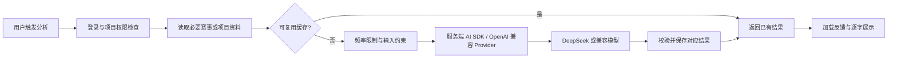

- 密钥只在服务端读取，浏览器不会直接携带模型 API Key。
- 赛道分析按赛事资料版本缓存，资料更新后旧分析不再作为当前版本命中。
- 队伍匹配解释按用户资料、候选队伍及模型计算输入哈希，缓存 24 小时，并合并相同的进行中请求。
- 模型调用设有超时和用户级频率限制。招募草稿、项目教练不会因为重复打开页面自动生成。
- 未配置 AI 时：队伍匹配仍可展示规则结果；赛道分析、招募生成与项目教练会明确提示需要配置，不能假装生成成功。
- **输出方式**：当前主要使用 AI SDK `generateText`，服务端返回完整结果后，前端用逐字动画呈现；不是模型 Token 的实时 SSE 推送。

## 3. 页面截图

以下为 **2026-11-10 使用隔离数据库和演示账号采集的实际页面截图**。项目、成员、任务和教练报告包含用于截图的示例数据，不表示真实用户资料、真实模型调用结果或实时运营统计。首页部分宣传数字、项目风险标签及辅助说明仍属于设计展示，不能作为自动诊断或真实规模证明；请以实际业务列表、任务完成度和保存的报告为准。在线演示站的数据可能不同。

### 首页

提供产品入口，以及可暂停、重播、切换步骤的一分钟交互工作流演示。

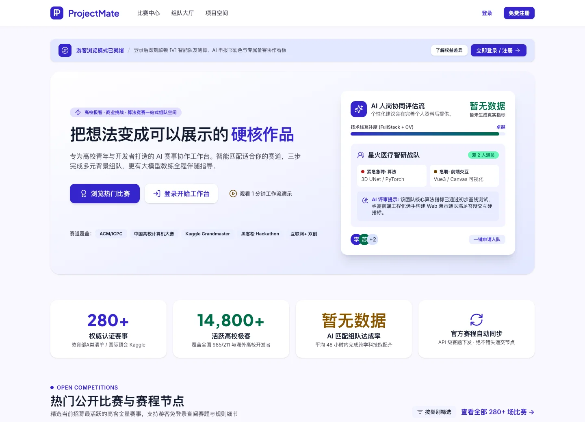

### 比赛中心与组队大厅

搜索赛事、收藏与推荐，并围绕关联赛事寻找队友。

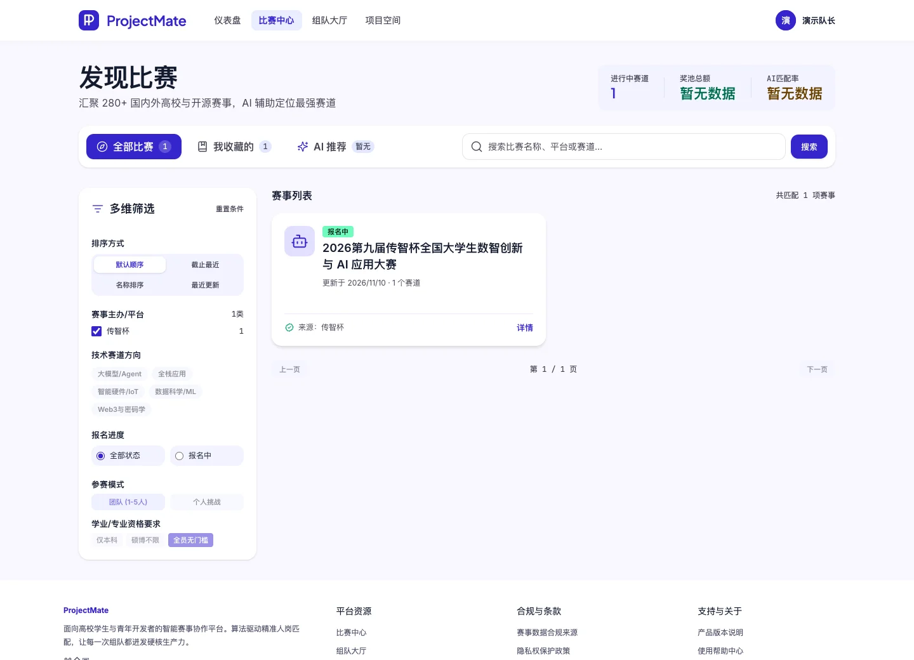

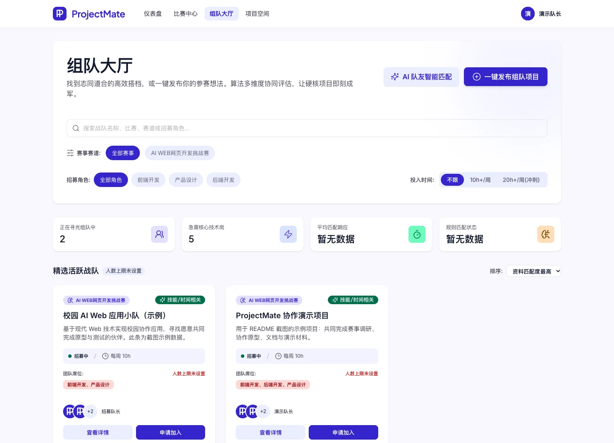

### 个人仪表盘

汇总参与的项目、待办、收藏、近期截止期及通知。

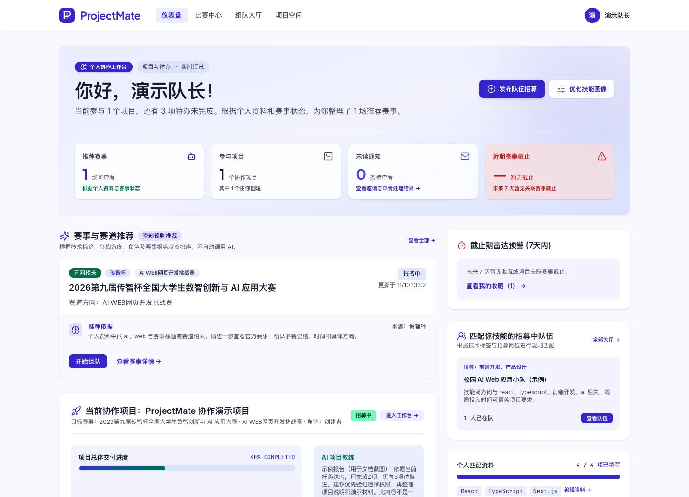

### 项目概览与任务看板

同一套项目标题、指标和标签栏，切换不同协作模块。

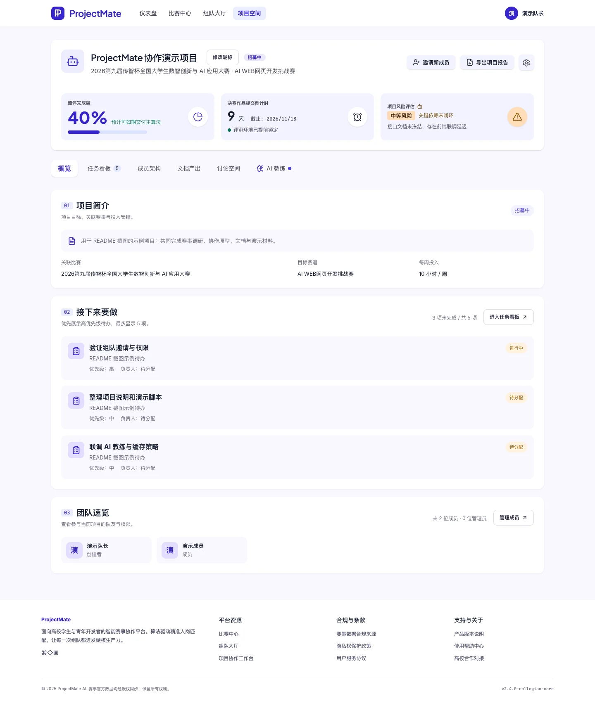

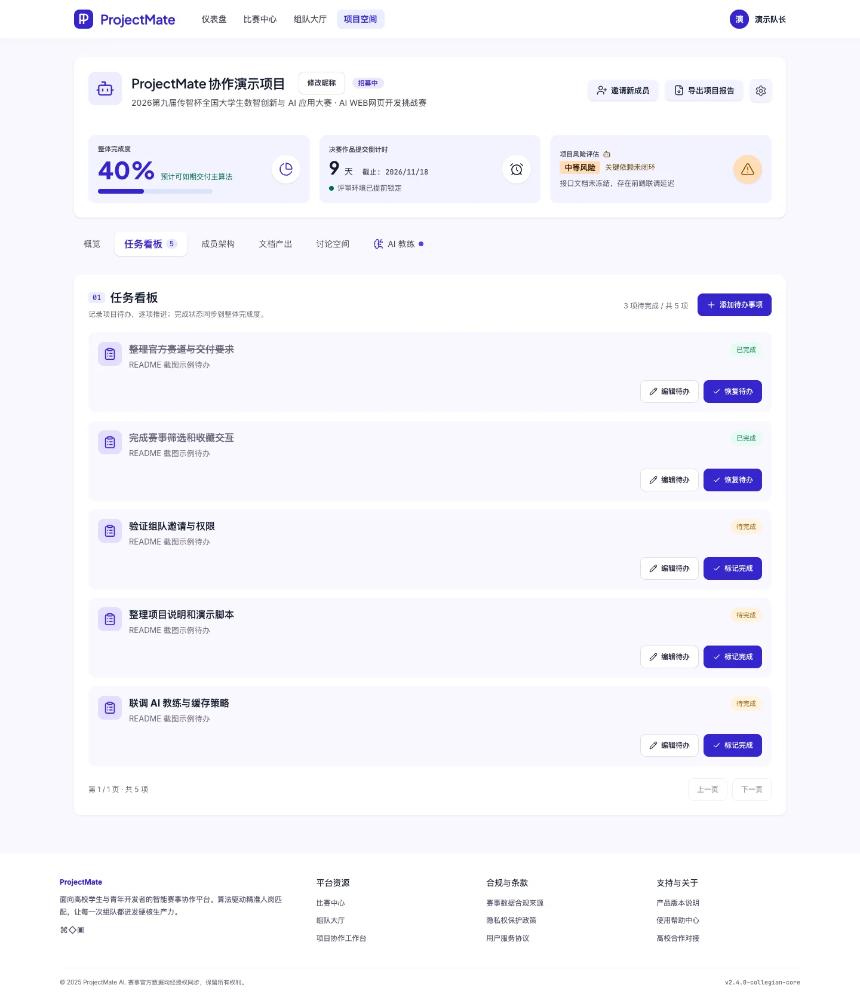

### 讨论、文档与 AI 教练

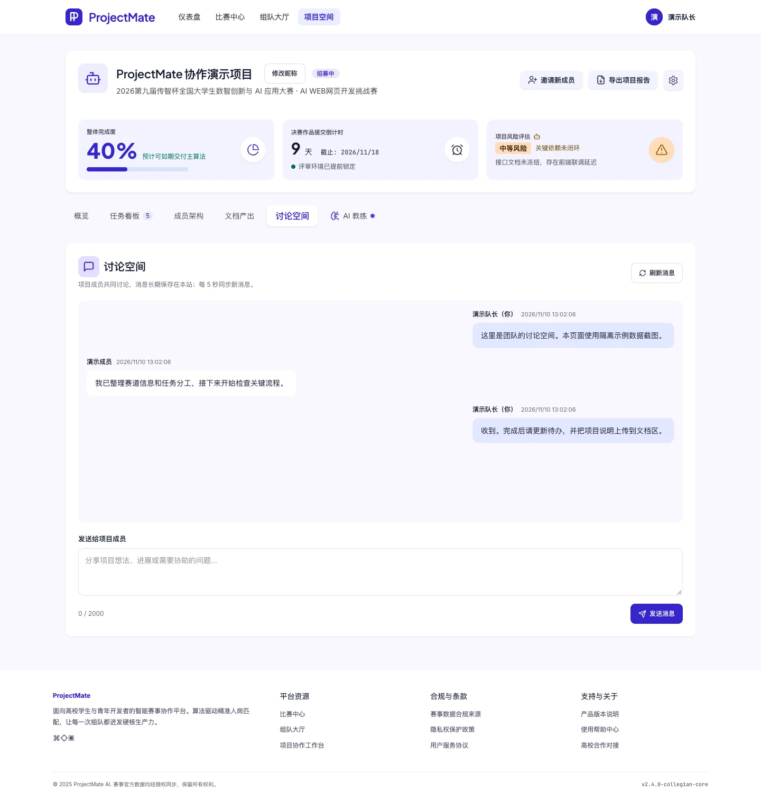

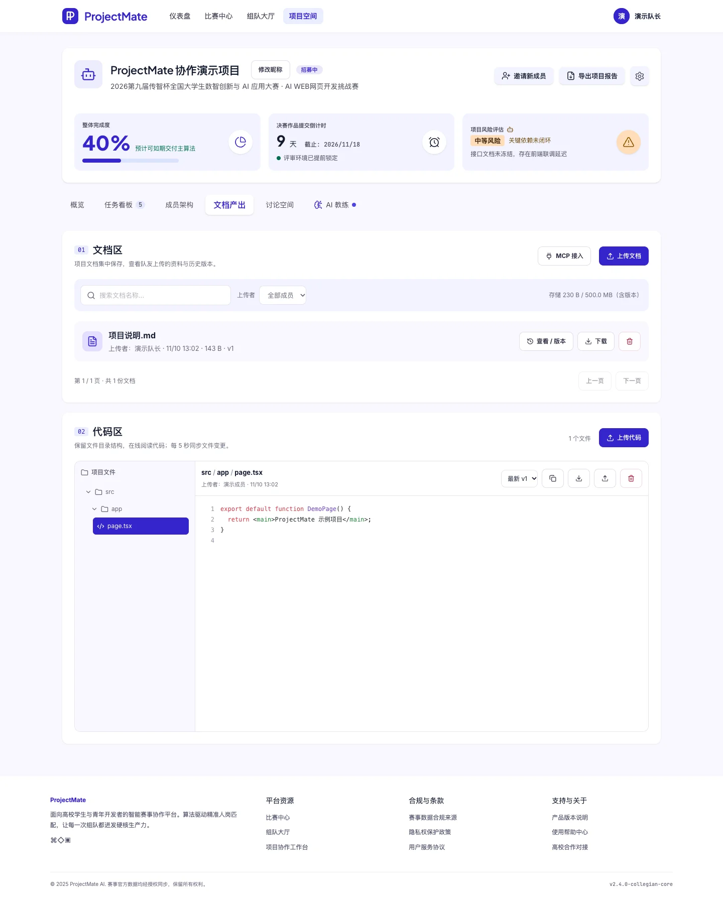

教练截图中的报告为明确标注的示例报告，未为拍摄截图消耗模型 Token。

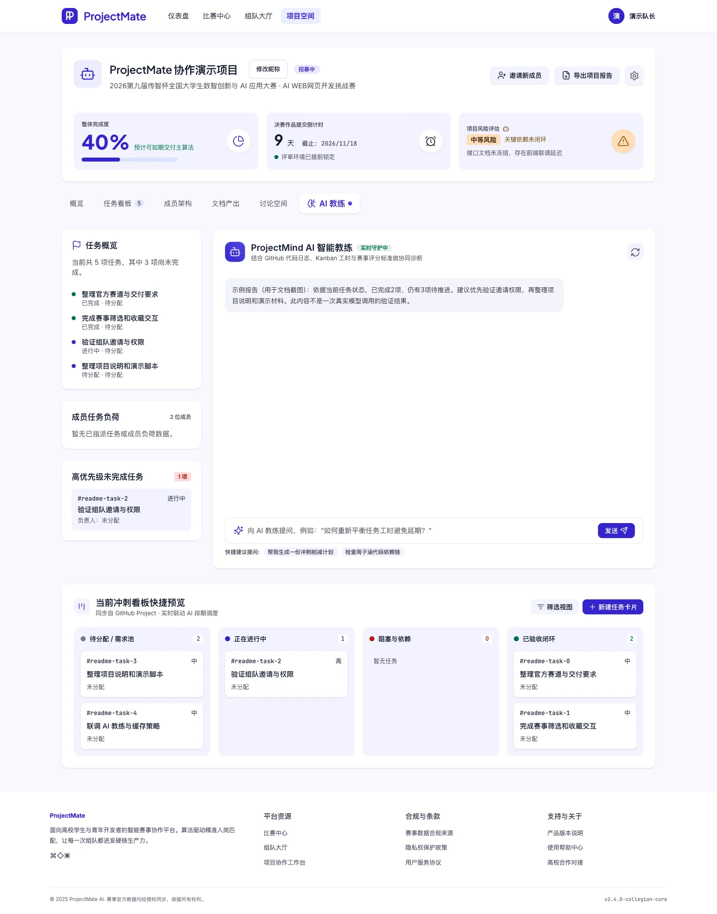

## 4. 技术栈与系统架构

### 前端

| 技术 | 用途 |
| --- | --- |
| Next.js 15 / App Router | 页面路由、服务端渲染、Server Components、全栈入口 |
| React 19 | 客户端组件、表单状态、弹窗与页面交互 |
| TypeScript 5 | 前后端类型约束 |
| Tailwind CSS 4 + CSS | 全站设计变量、布局、响应式适配及动画 |
| Lucide React | SVG 图标 |
| React Markdown / Shiki | Markdown 内容和代码语法高亮预览 |

### 后端与基础设施

| 技术 | 用途 |
| --- | --- |
| Node.js / Next.js Route Handlers、Server Actions | 认证、业务读写、模型代理、上传与下载；无需另启动 Python 服务 |
| SQLite / better-sqlite3 | 本地文件数据库、事务与持久化 |
| Drizzle ORM / Drizzle Kit | Schema 定义及数据库开发工具；完整运行时建表由初始化模块负责 |
| Auth.js（next-auth v5 beta） | Credentials 会话及认证集成；GitHub 使用站内 OAuth 绑定流程 |
| Vercel AI SDK 4 / `@ai-sdk/openai` | DeepSeek 等 OpenAI 兼容模型接入 |
| MCP TypeScript SDK | 项目授权、文件工具、Streamable HTTP 传输 |
| Nodemailer | SMTP 邮件与 HTML/纯文本模板 |
| otplib / qrcode | TOTP 两步验证与绑定二维码 |
| Sharp / docx / Zod | 头像处理、Word 报告生成、结构校验 |
| Cheerio | 设计模板内容装配和公开赛事页面解析 |
| Docker / Compose / Nginx | 容器部署、持久卷、反向代理；可接 EdgeOne |

具体解析版本以 [package-lock.json](package-lock.json) 为准，依赖声明见 [package.json](package.json)。

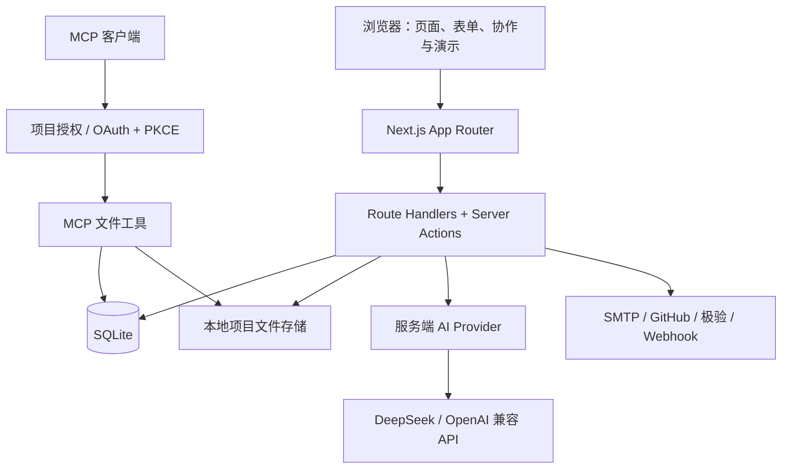

## 5. 运行环境

| 项目 | 要求或建议 |
| --- | --- |
| Node.js | 建议 Node.js 22 LTS，与 Dockerfile 主版本一致 |
| 包管理器 | npm，使用仓库内 `package-lock.json` 和 `npm ci` |
| 系统 | macOS、Linux 或 Windows；脚本 `build.sh` / `deploy.sh` 使用 Bash |
| 本地资源 | 可写数据库目录、可写上传目录；无需外部 MySQL、Redis 或向量库 |
| Docker | Docker Engine 和支持 `docker compose up --wait` 的 Compose 插件 |
| 外部连接 | 按需访问模型、SMTP、GitHub、极验与赛事公开数据源 |
| 浏览器 | 支持现代 JavaScript 的 Chrome、Edge、Firefox、Safari |

`better-sqlite3` 为原生模块。若当前平台未提供预编译文件，需要 Python 3、make、C/C++ 编译工具；Windows 可安装相应的 C++ Build Tools。Dockerfile 已在构建阶段安装 SQLite 原生编译所需工具。

## 6. 快速本地部署

### 6.1 获取源码与安装依赖

```bash
git clone https://github.com/ZherKing/ProjectMate.git
cd ProjectMate
npm ci
cp .env.example .env
```

Windows PowerShell 可用 `Copy-Item .env.example .env` 复制配置。

### 6.2 填写最小配置

编辑 `.env`：

```ini
DATABASE_URL=file:./database.sqlite
STORAGE_PATH=./storage
AUTH_URL=http://localhost:3000
AUTH_SECRET=替换成你自己生成的随机密钥
GEETEST_ENABLED=false
```

生成随机密钥：

```bash
node -e "console.log(require('node:crypto').randomBytes(32).toString('hex'))"
```

`AUTH_SECRET` 应保持稳定；除会话外，它还用于派生数据库中 SMTP、2FA 等敏感配置的加密密钥。保留 `.env` 在本地，不提交仓库。

### 6.3 启动开发服务器

```bash
npm run dev
```

访问 [http://localhost:3000](http://localhost:3000)。应用会按需创建数据表并执行兼容性字段初始化，无需先手动创建数据库或运行 Drizzle 迁移。数据库父目录需存在且可写。

首次初始化的示例数据与账号说明见[默认账号与权限](#10-默认账号与权限)。需要真实赛事时，可运行公开数据源同步，再由管理员审核。

### 6.4 开启 AI 功能（可选）

```ini
AI_API_KEY=你的服务端模型密钥
AI_BASE_URL=https://api.deepseek.com
AI_MODEL=deepseek-chat
```

模型名应使用你的服务账号当前支持的名称。修改配置后重启开发服务；模型服务未配置时仍可体验赛事浏览、组队、任务、讨论、文件等功能。

### 6.5 本地生产模式

先停止占用相同端口的开发服务器，再执行：

```bash
npm run build
npm run start
```

开发服务与生产构建不要同时写同一 `.next` 目录。如需并行验证，用独立的 `NEXT_DIST_DIR`，且 `build` 与 `start` 必须使用同一个目录。

## 7. Docker 构建与部署

### 7.1 本机构建并导出压缩包

```bash
./build.sh 1.0.0
```

生成 `artifacts/projectmate-1.0.0-amd64.zip`，包含镜像 TAR、部署脚本、Compose 配置、`.env.example`、版本信息和部署说明；不包含数据库、上传文件或本地 `.env`。构建机需安装 `zip`。默认目标平台为常见服务器的 `linux/amd64`；ARM64 服务器使用：

```bash
PROJECTMATE_PLATFORM=linux/arm64 ./build.sh 1.0.0
```

可通过第二参数自定义镜像名，`PROJECTMATE_OUTPUT_DIR` 指定导出目录。脚本不启动本机服务、不推送，拒绝 `latest` 及覆盖已有同名压缩包。

### 7.2 上传服务器并导入部署

上传 ZIP 到服务器固定部署目录并解压。首次运行自动生成随机 `AUTH_SECRET`，交互询问实际 `AUTH_URL`；无交互时提示编辑生成的 `.env` 后重新运行。首次生成密钥需安装 `openssl`。已有 `.env` 不会覆盖。

```bash
# 本机执行，替换服务器信息
scp artifacts/projectmate-1.0.0-amd64.zip user@server:/srv/projectmate/

# 服务器执行（每次升级使用同一部署目录）
cd /srv/projectmate
unzip -o projectmate-1.0.0-amd64.zip
bash deploy.sh
```

按提示输入实际镜像包文件名（例如 `projectmate-1.0.0-amd64.tar`），脚本检查文件并导入后识别版本；多标签时要求选择，不再依赖 `release.txt` 的旧文件名。

脚本校验归档、通过 `docker image load` 导入、确认精确版本标签，再部署并等待 HTTP 健康检查；不从镜像仓库拉取。服务器只需 Docker/Compose，无需源码或 Node 环境。只导入可信的包，并确保构建平台与服务器 CPU 架构一致。

默认端口 `3000`，可设置 `PROJECTMATE_PORT`；`.env` 路径由 `PROJECTMATE_ENV_FILE` 指定，Compose 项目名由 `COMPOSE_PROJECT_NAME` 指定。若镜像已手动导入，仍可运行 `./deploy.sh projectmate:1.0.0 --local`。

### 7.3 持久化与升级

| 内容 | 容器路径 |
| --- | --- |
| SQLite 数据库 | `/app/data/database.sqlite` |
| 项目文件存储 | `/app/data/storage` |
| 持久卷 | `projectmate-data`，默认实际卷名 `projectmate_projectmate-data` |

保持同一个 Compose 项目名可复用数据。脚本不执行 `down -v`；切换项目名会使用另一份卷，本地数据库也不会自动复制到 Docker 卷。备份和迁移应在停止写入后显式进行。回退镜像前需确认数据格式兼容。

### 7.4 EdgeOne + Nginx

可在源站 Nginx 配置 HTTP 80 回源至宿主机 `127.0.0.1:3000`，由 EdgeOne 终止 HTTPS，源站不需要证书。若工作区已另行配置 `nginx.conf`，将其中的占位域名替换为实际域名，作为 `/etc/nginx/conf.d/projectmate.conf` 使用，先 `nginx -t` 再重载。该文件不作为运行应用的前置依赖。

EdgeOne 保留回源 Host，启用边缘 HTTPS，并绕过动态页面与 API 缓存；`.env` 的 `AUTH_URL` 仍使用公网 HTTPS 域名。该文件是站点片段，不能直接覆盖 Nginx 主配置。

Docker 详细操作及配置边界见 [DEPLOYMENT.md](DEPLOYMENT.md)。

## 8. 环境变量

模板见 [.env.example](.env.example)。Next.js 自动加载 `.env` / `.env.local`，同名配置通常由 `.env.local` 优先；排查时注意是否存在旧值。Node/tsx 独立脚本不会自动采用相同规则，示例命令会显式加载 `.env`。

### 基础与 AI

| 变量 | 默认或示例 | 用途 |
| --- | --- | --- |
| `DATABASE_URL` | `file:./database.sqlite` | SQLite 文件位置 |
| `STORAGE_PATH` | `./storage` | 上传文件存储根目录 |
| `AUTH_SECRET` | 自行生成 | 会话与敏感配置加密密钥，不能使用模板值上线 |
| `AUTH_URL` | `http://localhost:3000` | 外部访问地址；生产填写 HTTPS 域名，MCP 与 OAuth 使用它构造地址 |
| `ADMIN_EMAILS` | 留空；多个邮箱用逗号分隔 | 全站管理员白名单，登录时同步角色 |
| `AI_API_KEY` | 留空 | 服务端模型密钥 |
| `AI_BASE_URL` | `https://api.deepseek.com` | OpenAI 兼容模型接口地址 |
| `AI_MODEL` | `deepseek-chat` | 模型名，按服务账号可用模型配置 |
| `PROJECT_FILE_MAX_MB` | `20` | 单文件大小上限 |
| `PROJECT_STORAGE_MAX_MB` | `500` | 每项目存储配额，包含历史版本 |

### 登录、通知与 MCP

| 变量 | 默认或示例 | 用途 |
| --- | --- | --- |
| `GITHUB_CLIENT_ID` / `GITHUB_CLIENT_SECRET` | 留空 | GitHub OAuth App；未配置不能使用 GitHub 登录/绑定 |
| `GEETEST_ENABLED` | `false` | `true` 或 `1` 开启登录注册相关人机验证，仅环境配置可启用 |
| `GEETEST_ID` / `GEETEST_KEY` | 留空 | 极验 4.0 验证 ID / 服务端密钥，启用后必须配置 |
| `NOTIFICATION_CRON_SECRET` | 留空 | 外部定时调用通知投递接口的 Bearer 密钥 |
| `MCP_ALLOWED_ORIGINS` | 留空 | 额外允许的浏览器 MCP Origin，多个用逗号分隔；桌面客户端通常不需要 |

GitHub 回调地址为 `AUTH_URL` + `/api/settings/github/callback`。通知 SMTP 在管理员后台 `/admin/settings` 配置并保存到本站数据库，**没有要求填写 `SMTP_HOST` 等未实现的环境变量**。用户还需在通知页验证自己的通知邮箱。

极验默认关闭。启用后，缺少正确 ID/Key、SDK 加载失败或服务端二次验证失败都会阻止受保护认证；它不替代邮箱验证码或已启用的 2FA。

### 赛事数据源

| 变量 | 默认或示例 | 用途 |
| --- | --- | --- |
| `CRAWLER_USER_AGENT` | `ProjectMateBot/1.0` | 抓取请求标识 |
| `BOXUEGU_TRACK_API_URL` | 留空时使用内置公开接口 | 传智杯赛道接口覆盖 |
| `BOXUEGU_CONTESTS_URL` | `https://www.boxuegu.com/matchTrack/` | 赛事入口配置；目前传智杯适配器主要读取公开 JSON 接口 |
| `SAIKR_API_URL` | 留空 | 可选赛氪 JSON 来源 |
| `XIAOYUAN172_CONTESTS_URL` | 模板中的 172 校园赛事分类地址 | 公开赛事列表入口 |
| `XIAOYUAN172_MAX_PAGES` | `3` | 抓取分页数量 |

### 可选运行与部署参数

| 变量 | 用途 |
| --- | --- |
| `NEXT_DIST_DIR` | 分离开发/构建产物，例如 `.next-dev`；构建与启动时保持一致 |
| `AUTH_TRUST_HOST` | 经可信反向代理运行时，按 Auth.js 部署环境需要配置 |
| `NOTIFICATION_DISABLE_WORKER` | `true` 关闭常驻通知投递 worker，改由外部定时投递 |
| `SAIKR_CONTESTS_URL` | 覆盖赛氪公开页面入口 |
| `PROJECTMATE_PLATFORM` | 构建目标平台，默认 `linux/amd64`，也支持 `linux/arm64` |
| `PROJECTMATE_OUTPUT_DIR` | 构建导出目录，默认 `artifacts/` |
| `PROJECTMATE_ENV_FILE` | `deploy.sh` 使用的环境文件路径 |
| `PROJECTMATE_PORT` | Docker 映射到宿主机的端口，默认 `3000` |
| `COMPOSE_PROJECT_NAME` | 部署项目名，默认 `projectmate`，影响持久卷名称 |

## 9. 文件目录结构与用途

```text
ProjectMate/
├── assets/screenshots/        # README 实际页面截图（隔离示例数据）
├── public/assets/             # Logo、默认头像与字体等公开静态资源
├── src/
│   ├── app/                   # App Router 页面、布局、样式及 Route Handlers
│   │   ├── api/               # 认证、项目、文件、通知、管理员与 MCP HTTP 接口
│   │   ├── competitions/      # 全部比赛、收藏、推荐、详情入口
│   │   ├── teams/             # 组队大厅与发布入口
│   │   ├── projects/          # 概览、任务、成员、讨论、文件、教练、邀请
│   │   ├── settings/          # 资料、安全、连接、通知与注销
│   │   ├── admin/             # 审核、来源、用户、日志与网站设置
│   │   ├── dashboard/         # 登录用户个人工作台
│   │   └── mcp/               # MCP 授权确认与错误页面
│   ├── components/
│   │   ├── design/            # 页面模板装配、共享项目模块、交互和 Server Actions
│   │   ├── layout/            # 统一导航、页脚、头像与路由加载反馈
│   │   ├── projects/          # 邀请与队伍匹配卡片
│   │   └── settings/          # 安全、GitHub、通知、修改邮箱等交互组件
│   ├── design/                # 设计模板、主题、字体与发布项目模板
│   ├── lib/
│   │   ├── ai/                # Provider、分析/草稿/教练、缓存及限频
│   │   ├── auth/              # 密码、角色、权限与前端验证码接入
│   │   ├── security/          # 验证码、2FA、会话凭据、邮箱变更及极验
│   │   ├── db/                # SQLite 连接、运行时初始化及各业务查询
│   │   ├── crawler/           # 数据源适配、归一化与同步脚本
│   │   ├── files/             # 文件类型校验、配额、存储、版本与分片上传
│   │   ├── mcp/               # OAuth/PKCE、令牌与项目文件工具
│   │   ├── teams/             # 能力规则匹配与 AI 解释缓存
│   │   ├── notifications/     # 事件、投递队列与 Webhook
│   │   ├── email/             # 品牌邮件模板
│   │   ├── github/            # OAuth 绑定与登录业务
│   │   ├── account/           # 头像、项目转让与账号生命周期
│   │   ├── mailer.ts          # SMTP 发送器
│   │   └── site-settings.ts   # 站点配置与敏感设置加密
│   └── auth.ts                # Auth.js Provider、JWT 与会话校验
├── tests/                     # Node Test Runner 功能回归测试
├── .env.example               # 环境变量模板，不包含真实密钥
├── Dockerfile                 # 多阶段构建与非 root 运行镜像
├── docker-compose.yml         # 从源码构建的基础 Compose 入口
├── docker-compose.deploy.yml  # 指定版本镜像、健康检查与持久卷
├── build.sh                   # 构建镜像并生成 ZIP 发布包
├── deploy.sh                  # 交互输入镜像包、识别版本并部署
├── DEPLOYMENT.md              # 部署与反向代理补充说明
├── drizzle.config.ts          # Drizzle 数据库开发工具配置
├── next.config.ts             # standalone 输出与构建目录配置
├── package.json               # 依赖声明和命令
└── package-lock.json          # npm 依赖锁定
```

运行后可能生成 `database.sqlite`、`storage/`、`.next/` 等本地数据；它们不属于应提交的源码。`tasks/` 是本地工作记录目录，已忽略，不作为运行依赖。

## 10. 默认账号与权限

### 本地演示账号

| 项目 | 值 |
| --- | --- |
| 邮箱 | `暂时不公开，请在交付文档查看` |
| 密码 | `暂时不公开，请在交付文档查看` |
| 创建条件 | `users` 表为空时执行种子初始化 |
| 默认角色 | 普通用户，不是固定管理员 |

如果已注册其他用户，该账号不一定存在；种子不会重置已有账号密码。初始化还可能写入示例赛事和 `demo-project` 示例任务，其中示例来源为 `example.com`，不能当成真实赛事或自动创建好的团队。实际项目请在组队大厅创建。

上述邮箱不是可收信地址，邮箱验证码、2FA 绑定与通知演示应使用自己可收信的账号。公开部署不要继续保留公开密码作为重要账号；建议为评审单独创建最小权限测试账号。**在线演示站不保证接受此本地默认账号。**


### Docker 评审演示账号与数据

镜像包含可选演示数据初始化器，**默认关闭**。在服务器 `.env` 中设置：

```ini
DEMO_DATA_ENABLED=true
DEMO_ACCOUNT_EMAIL=judge@projectmate.local
DEMO_ACCOUNT_PASSWORD=替换为你自己设置的12至128位密码
```

部署包含此功能的新版本镜像并重建容器后，会导入普通权限的评审账号及以下内容，不需要进入容器执行 tsx，也不会把账号密码固化进镜像：

- 8 场带“【演示】”标记的虚构赛事，16 条示例赛道；5 个收藏。
- 3 个可切换协作项目（2 个为创建者，1 个为成员）和另外 6 个招募项目，含岗位、时间、人数状态。
- 7 位虚构成员、36 项待办、64 条讨论、2 条待处理入队申请。
- 3 份文档、3 个代码文件和文档历史版本；预置教练报告及4条站内通知。

这些记录仅用于评审体验，不代表真实赛事、人员、模型输出或成果；不会调用 AI、发送邮件或 Webhook。真实传智杯赛事仍通过管理员同步与审核流程获取，不会被演示数据覆盖。导入后，虚构赛事及招募项目对站内访客也可见。

首次导入会检查邮箱冲突，拒绝接管已有账号；演示邮箱不能加入 `ADMIN_EMAILS`。重复启动不重置密码、任务状态、讨论或评委修改。导入完成后可将 `DEMO_DATA_ENABLED=false` 并重建容器，已有演示数据保留。该开关不是清理/重置按钮，修改环境密码也不会重置已经创建的账号。

将邮箱与密码通过评审渠道交付，不在公开 README 发布真实密码。`.local` 邮箱只适合密码登录，不可收信；如需演示邮箱验证码功能，应使用你实际控制的邮箱。服务器日志仅报告导入状态，不输出密码；出现冲突、密码长度或文件权限错误时查看日志，应用不会用错误配置覆盖已有用户。

### 管理员设置

1. 注册并使用自己的邮箱。
2. 将该邮箱添加到 `.env` 的 `ADMIN_EMAILS`，多个邮箱用逗号分隔。
3. 重启服务并重新登录，使账号角色同步。
4. 进入 `/admin`；权限同时检查邮箱白名单和数据库角色，不能只改前端入口。

项目创建者、项目管理员、普通成员的协作权限与全站管理员身份独立。成员移除后，项目文件、讨论及 MCP 授权都会继续执行访问校验。

## 11. 前端页面与路由

| 路径 | 页面或用途 | 主要访问条件 |
| --- | --- | --- |
| `/` | 首页、产品介绍、一分钟交互演示 | 公开 |
| `/login`、`/register` | 登录、注册 | 公开，按配置启用极验 |
| `/competitions` | 全部比赛、搜索与筛选 | 浏览公开；收藏与分析需登录 |
| `/competitions/favorites` | 我的收藏 | 登录 |
| `/competitions/recommendations` | 资料规则推荐 | 登录 |
| `/competitions/detail` | 详情兼容入口；主要从比赛列表打开详情卡片 | 依页面入口与登录状态 |
| `/teams` | 组队大厅、筛选、队伍详情、能力匹配 | 浏览公开；发布/申请/匹配需登录 |
| `/teams/create` | 发布入口，实际使用大厅内发布卡片 | 登录 |
| `/dashboard` | 个人仪表盘 | 登录 |
| `/projects` | 当前项目概览 | 登录，项目数据按成员权限读取 |
| `/projects/tasks` | 任务看板 | 登录；写操作按项目权限 |
| `/projects/members` | 成员架构、邀请与入队申请 | 登录；管理操作限定角色 |
| `/projects/discussion` | 团队讨论 | 当前项目成员 |
| `/projects/files` | 文档、代码、版本及 MCP 入口 | 当前项目成员 |
| `/projects/coach` | AI 项目教练 | 登录；生成按当前创建者权限 |
| `/projects/invite?token=...` | 邀请详情与明确接受 | 按邀请状态及受邀账号校验 |
| `/settings`、`/profile` | 个人资料、技术主攻标签与方向 | 登录 |
| `/settings/security` | 密码、邮箱、2FA 与恢复码 | 登录并按操作验证身份 |
| `/settings/connections` | GitHub 与 MCP 连接 | 登录 |
| `/settings/notifications` | 通知邮箱、Webhook、消息记录 | 登录 |
| `/settings/danger` | 账号注销 | 登录及多重验证 |
| `/admin` | 赛事审核 | 全站管理员 |
| `/admin/sources`、`/admin/users` | 来源信息、用户管理 | 全站管理员 |
| `/admin/logs`、`/admin/settings` | 审计、SMTP 与网站设置 | 全站管理员 |
| `/mcp/authorize`、`/mcp/error` | MCP 授权确认及错误说明 | 授权流程相关校验 |

项目子页支持 `?project=<项目ID>`。切换页面时共用项目标题与标签模块，不需要为每个项目创建独立固定路由。

## 12. API 模块概览

后端由 **Route Handlers + Server Actions** 组成。下表中的 `{projectId}`、`{fileId}`、`{id}` 表示路径参数；大部分写接口要求站内会话及合法 Origin，不是匿名公共 API。

| HTTP 接口 | 方法 | 用途 |
| --- | --- | --- |
| `/api/auth/[...nextauth]` | GET / POST | Auth.js 登录、退出与会话 |
| `/api/register` | POST | 注册，返回一次性登录凭据 |
| `/api/auth/captcha` | GET / POST | 极验开关/公开 ID、服务端二次校验 |
| `/api/auth/email` | POST | 邮箱验证码登录与 2FA 阶段 |
| `/api/auth/github` | GET / POST | 发起 GitHub 登录，启用极验时先 POST 校验 |
| `/api/auth/recovery` | POST | 验证密码及邮箱，找回 2FA |
| `/api/settings`、`/api/avatars/{id}` | POST；GET | 保存个人资料/头像；读取头像 |
| `/api/settings/2fa` | GET / POST | 2FA 状态、绑定、停用和恢复码 |
| `/api/settings/password-code`、`/api/settings/password` | POST | 改密验证码、修改密码 |
| `/api/settings/email` | POST | 原/新邮箱验证、更换登录邮箱 |
| `/api/settings/account-code`、`/api/settings/account` | POST；GET / DELETE | 敏感操作验证码；注销预览与执行 |
| `/api/settings/github` | GET / POST | 绑定状态、绑定和解绑 |
| `/api/settings/github/callback` | GET | GitHub OAuth 回调 |
| `/api/settings/github/login` | GET / POST | GitHub 身份确认与 2FA 阶段 |
| `/api/settings/notifications` | GET / POST | 通知偏好、邮箱验证、Webhook 与测试 |
| `/api/notifications` | GET / POST | 消息/投递记录、已读、重试 |
| `/api/notifications/deliver` | POST | Bearer 保护的定时通知投递 |
| `/api/teams/match` | GET / POST | 规则匹配；AI 匹配解释及缓存 |
| `/api/projects/workspace` | GET / POST | 用户项目列表、切换当前项目 |
| `/api/projects/discussion` | GET / POST | 历史/增量消息、幂等发送 |
| `/api/projects/invitations/accept` | POST | 明确确认后接受邀请 |
| `/api/projects/{projectId}/settings` | POST | 招募状态与人数上限 |
| `/api/projects/{projectId}/transfer` | POST | 身份验证后转让创建者 |
| `/api/projects/{projectId}/report` | GET | 下载 Word 项目报告 |
| `/api/projects/{projectId}/files` | GET / POST | 文件列表、用量、上传及新版本 |
| `/api/projects/{projectId}/files/{fileId}` | GET / DELETE | 预览、高亮、下载、版本与删除 |
| `/api/admin/settings`、`/api/admin/settings/test` | POST | SMTP/站点设置、测试邮件 |
| `/api/mcp` | GET / POST / OPTIONS | Streamable HTTP MCP 端点 |
| `/api/mcp/connections` | GET / DELETE | 查看/撤销 MCP 连接 |
| `/api/mcp/oauth/register`、`token`、`revoke` | POST / OPTIONS | 客户端注册、令牌交换与撤销 |

**Server Actions**：赛事审核、收藏、发布项目、申请与审批入队、赛事分析、AI 招募草稿、项目教练、待办、项目昵称、成员管理等由 [`screenAction()`](src/components/design/actions.ts) 处理，不存在与这些操作一一对应的公开 REST 路由。

### MCP 文件工具

客户端连接 `https://你的域名/api/mcp`，经登录和项目授权后使用；支持 OAuth 授权码、PKCE、令牌轮换和撤销，工具权限受授权范围及当前项目成员身份限制。

- 读取：`list_projects`、`list_files`、`list_file_versions`、`read_file`。
- 写入：`upload_file`；大文件使用 `begin_upload`、`append_upload`、`finish_upload`，也可 `cancel_upload`。
- 工具在服务端校验路径、文件类型、权限、大小和配额；文件内容视作不可信资料。

## 13. 常用命令

```bash
# 安装锁定依赖
npm ci

# 开发 / 生产构建 / 生产启动
npm run dev
npm run build
npm run start

# 类型检查
npx tsc --noEmit --incremental false

# 全部回归测试（没有 npm test 脚本）
node --import tsx --test tests/*.test.ts

# 显式加载 .env 的数据种子 / 赛事同步（Node.js 22）
node --env-file=.env --import tsx src/lib/db/seed.ts
node --env-file=.env --import tsx src/lib/crawler/sync.ts

# 镜像构建导出 / 服务器导入部署
bash build.sh 1.0.0
# 服务器解压 ZIP 后，在部署目录执行
bash deploy.sh

# 代码差异格式检查
git diff --check
```

其他已有脚本：

| 命令 | 说明 |
| --- | --- |
| `npm run db:seed` | 运行种子；独立 tsx 进程不自动加载 Next 环境文件，建议使用上面的显式加载方式 |
| `npm run crawler:sync` | 同步数据源；同样注意环境文件与目标数据库 |
| `npm run db:generate` | Drizzle Schema 开发工具，不能替代运行时初始化 |
| `npm run db:migrate` | Drizzle 迁移入口；仓库未附完整业务迁移序列，不作为快速部署步骤 |
| `npm run db:studio` | Drizzle 开发查看器；自行确认配置和目标数据库 |
| `npm run lint` | 当前仍为旧 `next lint` 入口，未作为可用验收命令；请先用类型检查及测试 |

爬虫会按来源记录错误，单个来源失败可能不导致整个命令非零退出，需检查日志，不能只看“同步完成”。新抓取数据通常需管理员审核后公开。

## 14. 常见问题


### Docker 部署后没有“传智杯”来源？

镜像不携带本机 SQLite 数据库，容器初次启动也不会自动联网抓取赛事。来源筛选只显示已有审核通过赛事的平台。

1. 以管理员登录，进入 `/admin/sources`。
2. 在“传智杯”卡片点击“立即同步”，查看新增/更新数量或失败提示。
3. 到 `/admin` 审核新增赛事；通过后，比赛中心和来源筛选才会出现“传智杯”。

`BOXUEGU_TRACK_API_URL` 留空时使用内置公开接口。同步失败不会删除已有赛事；已有审核状态保持不变。同一来源间隔至少一分钟，不支持连续重复触发。Docker 首次使用此入口，需要重新构建并部署包含该功能的新版本镜像，旧压缩包不会自动更新。容器仍需能访问赛事公开来源。

### AI 仍提示没有配置，或者调用失败？

核对服务进程所在目录、`.env` 与 `.env.local` 的覆盖关系、`AI_API_KEY`、`AI_BASE_URL` 和账号可用的 `AI_MODEL`，修改后重启。分别检查网络、余额、授权和模型名称。不要把密钥粘贴进客户端或公开日志。

### 推荐页面没有结果，队伍匹配提示补资料？

先到个人设置填写“技术主攻标签与方向”，并补充角色、兴趣及每周投入。队伍匹配需要真实技能标签；候选还会排除已加入、自己创建、暂停招募或满员队伍。规则推荐不会保证每个人都有结果。

### 默认账号登不上？

它只在空用户表初始化时创建；已有数据库不会补建或重置。直接注册自己的账号即可。示例邮箱不支持收验证码，线上评审账号需要另行创建。

### 看不到后台，或者设置了白名单还没权限？

确认当前邮箱与 `ADMIN_EMAILS` 一致，重启并退出后重新登录。后台还校验数据库角色，不能只改页面显示。普通项目管理员不自动获得全站管理员权限。

### 为什么赛事链接打开了 example.com？

空数据库的种子包含示例赛事。请同步真实数据并审核，确认实际来源 URL；不要将种子记录当成官方数据。首页工作流演示也是明确标注的示例，不会创建真实团队。

### 邮件、GitHub 或极验不能用？

SMTP 由管理员后台设置，通知邮箱还需用户验证；GitHub 需要 OAuth App 和正确回调地址；极验需要自己的 ID、Key 和站点设置。账号 2FA 与人机验证是不同功能，启用极验不会绕过 2FA。未准备好极验配置时保持 `GEETEST_ENABLED=false`。

通知 worker 在常驻 Node 进程中每 15 秒尝试投递。若关闭 worker 或运行环境不常驻，可由外部定时任务 POST `/api/notifications/deliver`，使用 `Authorization: Bearer <NOTIFICATION_CRON_SECRET>`；不要公开此密钥。

### 项目任务、教练或昵称无法修改？

先选择自己有权限的真实项目；当前待办编辑、昵称与 AI 教练生成按创建者权限执行。邀请与成员管理也有创建者/管理员限制，不是所有成员均可修改。

### `.next/prerender-manifest.json` 缺失或 Client Manifest 报错？

先停止使用该构建目录的进程，再清理对应产物并重启或重新构建。避免 `next dev` 和 `next build` 同时写同一目录；不要在服务运行时删除其 `.next`。隔离构建时保持 `NEXT_DIST_DIR` 在构建和启动两阶段一致。

### 本地安装报 better-sqlite3 原生模块错误？

使用建议的 Node.js 版本重新安装依赖，避免复用不同 Node 版本或系统的 `node_modules`。没有对应预编译包时需配置 Python 和编译工具。Docker 镜像需在目标平台构建，不能复制宿主机原生依赖进容器。

### Docker 构建拉取基础镜像失败？

检查 Docker Engine、镜像仓库可达性、代理与网络配置。曾在开发环境遇到 `node:22-alpine` 元数据拉取失败；这不能当作镜像已构建成功。脚本会以失败退出，修复网络后重新构建。

### Docker 重启后数据像丢失了？

确认 Compose 项目名及实际持久卷是否一致；本地 SQLite 与容器卷是不同位置。不要执行 `docker compose down -v`，也不要覆盖运行中的数据库文件。先备份再迁移。

### Nginx 上传返回 413，或 AI/MCP 连接中断？

对齐应用文件限制、Nginx `client_max_body_size` 和 EdgeOne 上传限制；检查各层超时与缓存设置。Nginx 中应关闭流式接口的代理缓冲，边缘规则也需正确配置。Nginx 与应用同在宿主机时才使用 `127.0.0.1:3000`。

### 文档中的效果是否全部做过公网验证？

代码回归覆盖账号安全、项目权限、文件/MCP、讨论、极验与部署脚本等；实际页面已做隔离浏览器验证。模型、SMTP、GitHub、极验等外部服务的部分端到端验证采用本地模拟，不代表所有公网配置均已通过。当前 Docker 脚本和 Compose 配置已验证，但真实镜像构建曾受镜像源访问限制，Nginx 仍需在目标服务器执行 `nginx -t`。
